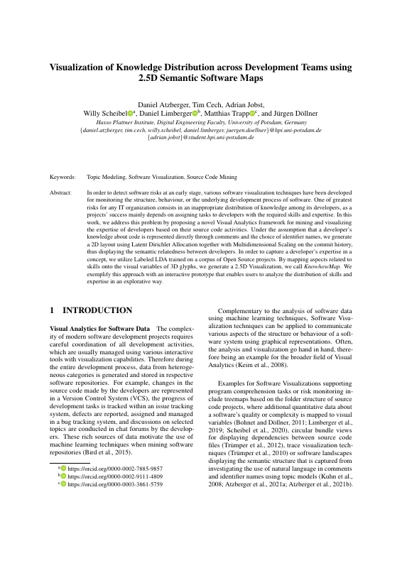
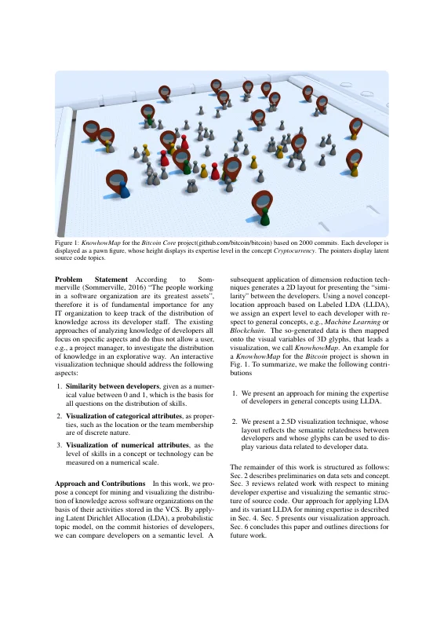
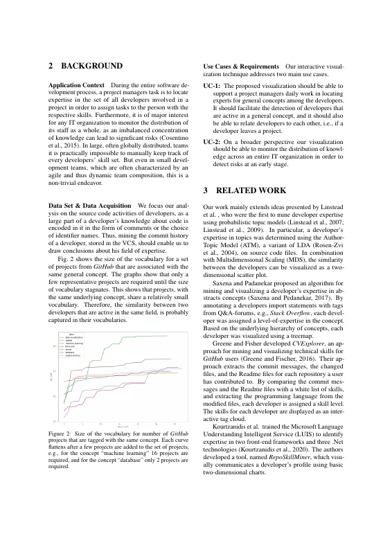
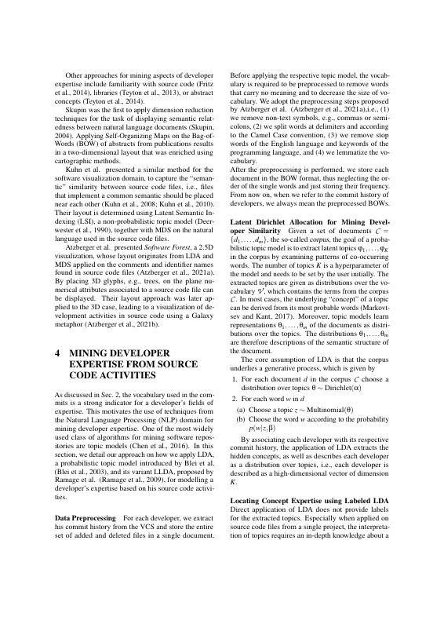
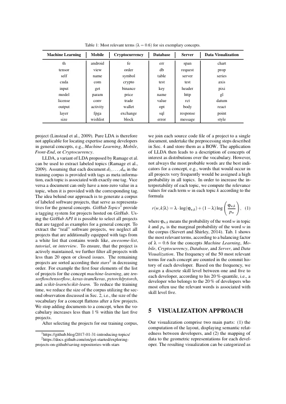
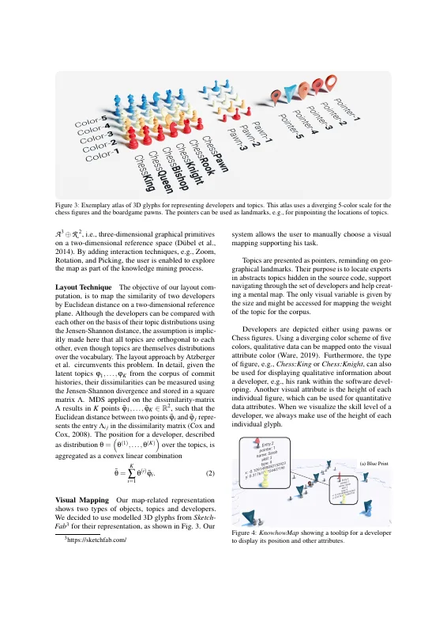
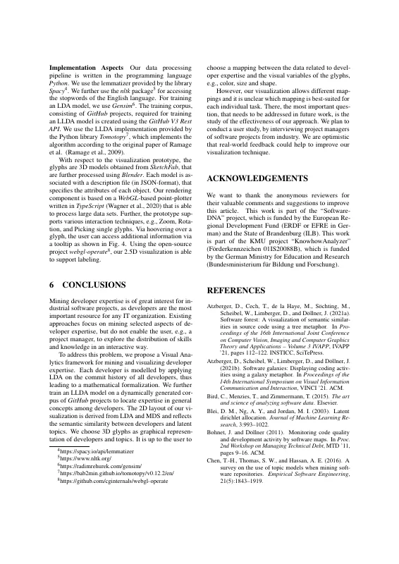
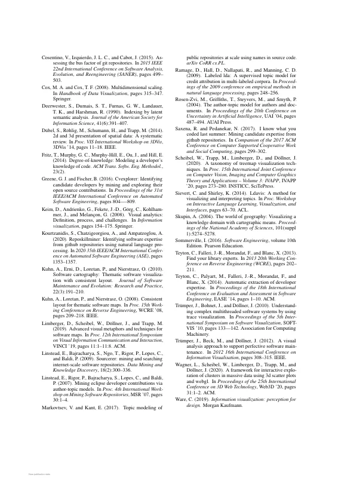

# Visualization of Knowledge Distribution across Development Teams using 2.5D Semantic Software Maps

Daniel Atzberger, [Tim Cech](https://orcid.org/0000-0001-8688-2419), [Adrian Jobst](https://orcid.org/0009-0007-4894-451X), [Willy Scheibel](https://orcid.org/0000-0002-7885-9857), [Daniel Limberger](https://orcid.org/0000-0002-9111-4809), [Matthias Trapp](https://orcid.org/0000-0003-3861-5759), and [Jürgen Döllner](https://orcid.org/0000-0002-8981-8583)

*Proceedings of the 17th International Joint Conference on Computer Vision, Imaging and Computer Graphics Theory and Applications - IVAPP (IVAPP '22)*, February 6–8, 2022, online. SciTePress, pp. 210–217.

[](https://doi.org/10.5220/0010991100003124) [](https://doi.org/10.5281/zenodo.24121993) [](https://www.researchgate.net/publication/358523984)

> In order to detect software risks at an early stage, various software visualization techniques have been developed for monitoring the structure, behaviour, or the underlying development process of software.
> One of greatest risks for any IT organization consists in an inappropriate distribution of knowledge among its developers, as a projects' success mainly depends on assigning tasks to developers with the required skills and expertise.
> In this work, we address this problem by proposing a novel Visual Analytics framework for mining and visualizing the expertise of developers based on their source code activities.
> Under the assumption that a developer's knowledge about code is represented directly through comments and the choice of identifier names, we generate a 2D layout using Latent Dirichlet Allocation together with Multidimensional Scaling on the commit history, thus displaying the semantic relatedness between developers.
> In order to capture a developer's expertise in a concept, we utilize Labeled LDA trained on a corpus of Open Source projects.
> By mapping aspects related to skills onto the visual variables of 3D glyphs, we generate a 2.5D Visualization, we call *KnowhowMap*.
> We exemplify this approach with an interactive prototype that enables users to analyze the distribution of skills and expertise in an explorative way.

<p><a href="atzberger2022-knowhow-map-as-submitted.pdf"></a> <a href="atzberger2022-knowhow-map-as-submitted.pdf"></a> <a href="atzberger2022-knowhow-map-as-submitted.pdf"></a> <a href="atzberger2022-knowhow-map-as-submitted.pdf"></a></p>
<details><summary>Remaining 4 pages</summary><p><a href="atzberger2022-knowhow-map-as-submitted.pdf"></a> <a href="atzberger2022-knowhow-map-as-submitted.pdf"></a> <a href="atzberger2022-knowhow-map-as-submitted.pdf"></a> <a href="atzberger2022-knowhow-map-as-submitted.pdf"></a></p></details>

## Contents

- [`src/`](src/) – LaTeX sources of the camera-ready version (SciTePress conference template), reconstructed, see below
- [`atzberger2022-knowhow-map-as-submitted.pdf`](atzberger2022-knowhow-map-as-submitted.pdf) – camera-ready PDF as published by the authors on ResearchGate (without the ResearchGate cover page)
- [`build.sh`](build.sh) – reproducible build with TeX Live 2021 (podman or docker)
- [`preview/`](preview/) – page previews for this README

## Build

```bash
./build.sh        # → build/main_cameraready.pdf
```

The SciTePress template files (`article.cls`, `SCITEPRESS.sty`, `apalike.sty`, `apalike.bst`) are bundled in `src/` and take precedence over the TeX Live versions.
`atzberger2022-knowhow-map-as-submitted.pdf` was built with TeX Live 2021 (pdfTeX 1.40.23), hence the TeX Live 2021 container; the build reproduces it (identical text and layout).
The build compiles a scratch copy of `src/` inside the container, so the ORCID logo (`orcid.eps`) can be converted to PDF.

**Reconstructed sources:** the last Overleaf state (2021-12-27) lacks five final author edits that are in the camera-ready PDF (2021-12-28) and in the published version: "assigned and managed" and "by the developers" (Section 1), "only a few" (was "not only a few", Section 2), the second sentence of the Figure 2 caption, and the URL footnotes for Gensim and webgl-operate (replacing a sentence on Gensim). These edits were re-applied to the Overleaf sources; the build then matches the camera-ready PDF word for word and in layout.

## Versions

- [`v1.0-camera-ready`](https://github.com/dl-archive/article.2022-ivapp-knowhow-map/tree/v1.0-camera-ready) – sources of the camera-ready version (reconstructed, see Build)

## Citation

```bibtex
@InProceedings{atzberger2022-knowhow-map,
  author    = {Atzberger, Daniel and Cech, Tim and Jobst, Adrian and Scheibel, Willy and Limberger, Daniel and Trapp, Matthias and D{\"o}llner, J{\"u}rgen},
  title     = {Visualization of Knowledge Distribution across Development Teams using 2.5D Semantic Software Maps},
  booktitle = {Proceedings of the 17th International Joint Conference on Computer Vision, Imaging and Computer Graphics Theory and Applications - IVAPP},
  year      = {2022},
  series    = {IVAPP~'22},
  publisher = {SciTePress},
  pages     = {210--217},
  doi       = {10.5220/0010991100003124},
  isbn      = {978-9-897585-55-5},
}
```
